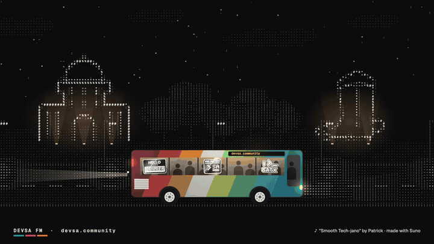
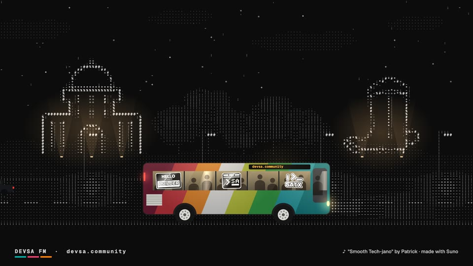
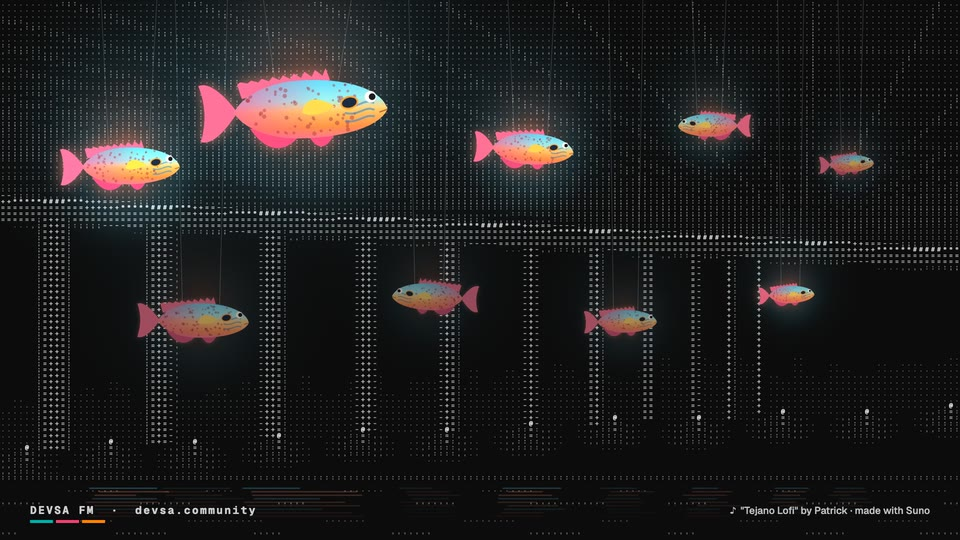
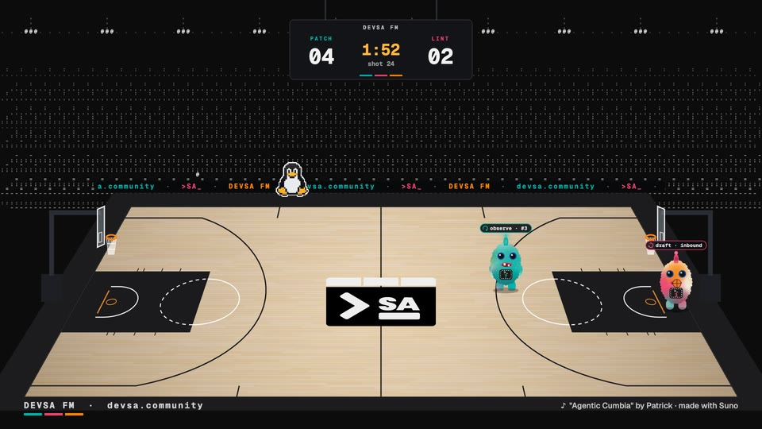
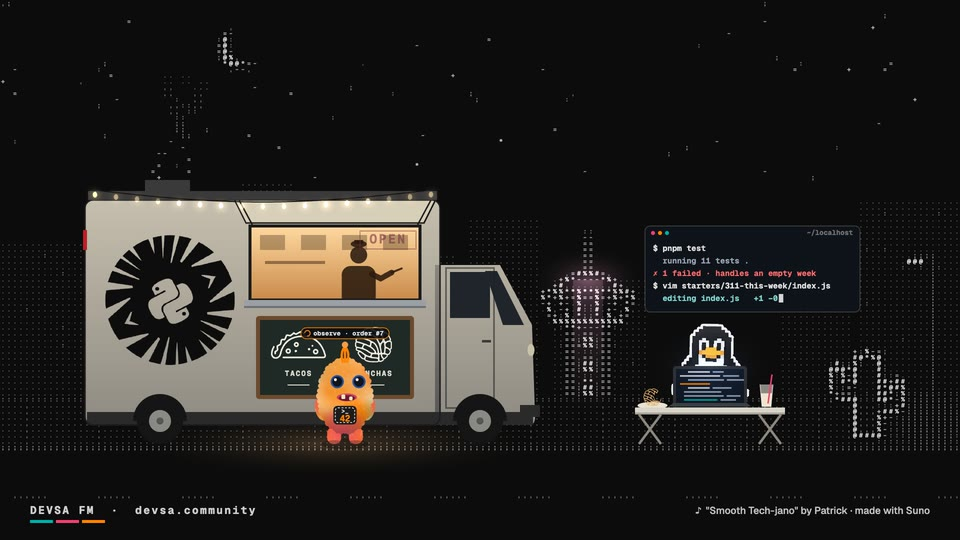
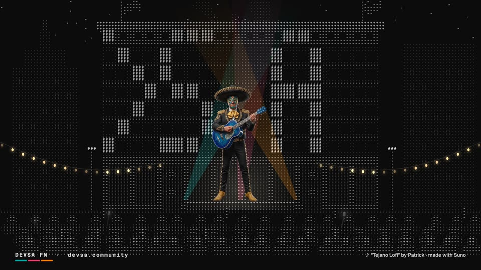
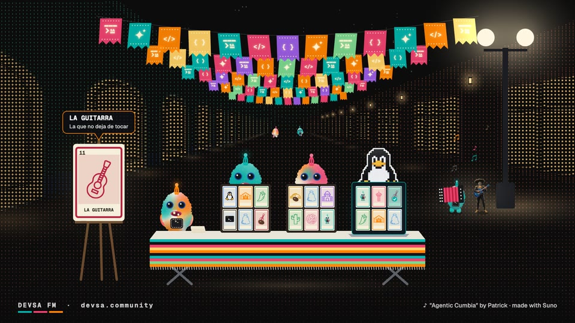
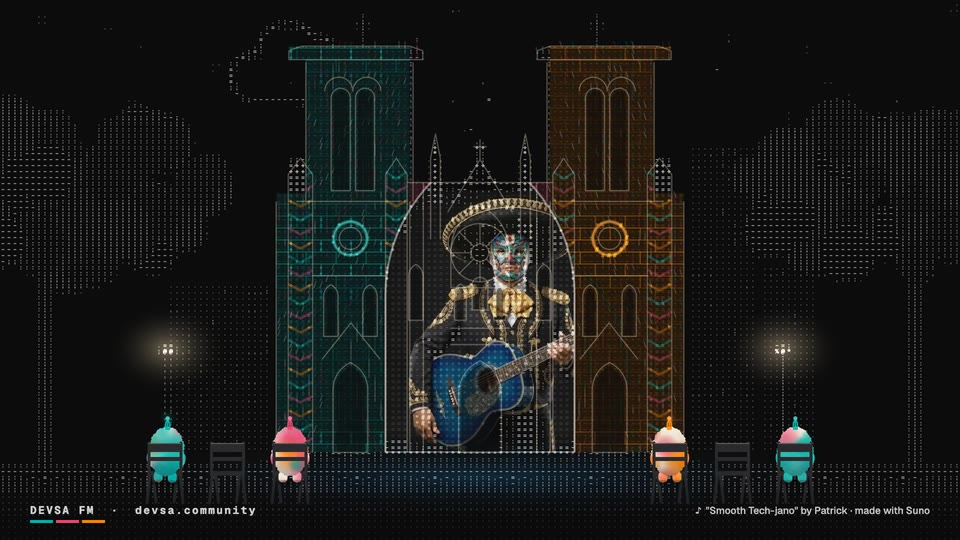
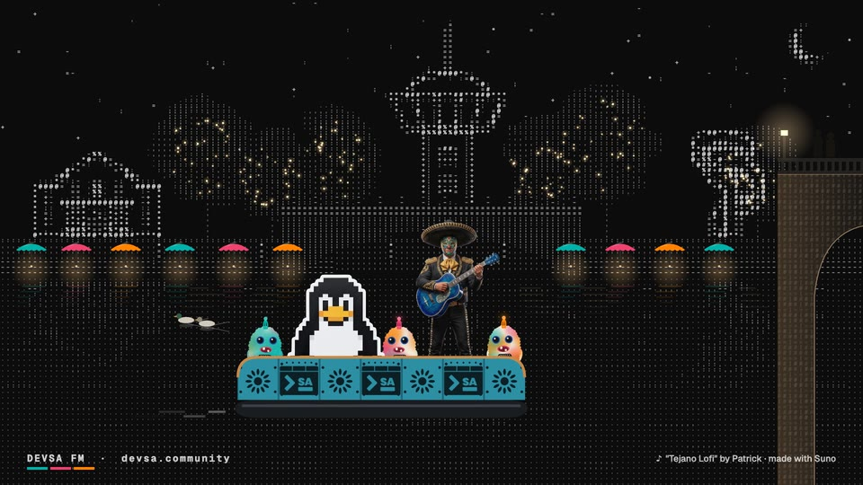

# DEVSA FM



**A night in San Antonio, in ASCII, with Tejano lofi.** DEVSA FM is a livestream on
[YouTube @devsatx](https://www.youtube.com/@devsatx) for San Antonio's learners and builders: the
River Walk, Market Square, San Fernando Cathedral and the rest of downtown, drawn in characters,
with DEVSA's agents, the Linux San Antonio penguin and the PySanAntonio mascot living in it.

It's built by [DEVSA](https://devsa.community), and **you can build a scene for it.** Every scene is one
HTML file that draws on a canvas: no framework, no build step.

**▶ Click any still below to open that scene live in your browser**: nothing to install. What DEVSA FM is and where to watch: [devsa.community/fm](https://www.devsa.community/fm).

→ **[Contributing guide](CONTRIBUTING.md)**: run it, make a scene, open a pull request.

```sh
git clone https://github.com/devsanantonio/devsa-fm.git && cd devsa-fm
npm install
npm run preview        # open http://localhost:8210
```

## On air

The night mix, in the order it plays. A scene from the community that joins it is credited here and in its footer.

| | | | |
|:-:|:-:|:-:|:-:|
| [](https://devsanantonio.github.io/devsa-fm/scene/commute.html?night) | [](https://devsanantonio.github.io/devsa-fm/scene/fish.html) | [](https://devsanantonio.github.io/devsa-fm/scene/court.html) | [](https://devsanantonio.github.io/devsa-fm/scene/taco.html) |
| **1. The night bus** · DEVSA | **2. Under the bridge** · DEVSA | **3. The game** · DEVSA | **4. The taco truck** · DEVSA |
| [](https://devsanantonio.github.io/devsa-fm/scene/rand.html) | [](https://devsanantonio.github.io/devsa-fm/scene/paseo.html) | [](https://devsanantonio.github.io/devsa-fm/scene/cathedral.html) | [](https://devsanantonio.github.io/devsa-fm/scene/riverwalk.html) |
| **5. The Rand** · DEVSA | **6. Lotería** · DEVSA | **7. San Fernando** · DEVSA | **8. The River Walk** · DEVSA |

## All the scenes

| Scene | What happens |
|---|---|
| `riverwalk` | night on the River Walk: a river barge carries the penguin, the PySanAntonio mascot and three agents downstream under the cypress lights |
| `commute` | the road past Mission San José on a VIA-style bus; `commute-night` is the same road after dark |
| `fish` | glowing fish under a bridge on the Museum Reach |
| `court` | a night game between two agents, intros to the final buzzer |
| `taco` | midnight at the Alamo Python taco truck: the penguin ships a feature at a folding table |
| `rand` | a concert at the Rand Building, the windows running a light show on the beat |
| `paseo` | lotería at Market Square: a caller, three players and a deck of DEVSA's own cards, under papel picado, with a conjunto under the lamp post |
| `cathedral` | San Fernando Cathedral with a projection show mapped to the stone, then DEVSA's conference films; agents watch from folding chairs |
| `dome` | a flying roadster on the street by the Alamodome |
| `ride` | the back seat of a driverless taxi heading downtown toward the Tower |
| `starter` | **the template**: copy it to start a scene |

Each scene is `scene/<name>.html`. Shared code is in `scene/fmkit.js` (the ASCII renderer, colours,
footer) and `scene/plush.js` (the agents).

## The night mix

On stream, `./stream.sh mix` plays a night in San Antonio:

**commute-night → fish → court → taco → rand → paseo → cathedral → riverwalk**, then round again
(about 24 minutes a round). The end follows the real walk downtown: Market Square, San Fernando on Main
Plaza, then the river.

Each scene is synced to one song: the loop is the song's full length and the scene moves on that song's
measured beat. Songs are dealt so no two scenes in a row share one; the table is in `scene_env` in
`stream.sh`. Music is "Tejano Lofi", "Agentic Cumbia" and "Smooth Tech-jano", by Patrick, made with Suno.

## Tools

| Command | What it does |
|---|---|
| `npm run preview` | serves the scenes at http://localhost:8210 to watch them loop in a browser |
| `npm run check -- <scene>` | checks a scene against the contract: runs without the optional assets, same frame for the same second, no seam in the loop. Pull requests run it automatically |
| `npm run still -- <scene> [seconds...]` | saves PNGs of a scene to `out/stills/` (for checking and pull requests) |
| `npm run clip -- <scene> "" [track.mp3]` | a shareable MP4 and GIF in `social/clips/` (needs ffmpeg; silent without the music) |
| `npm run site` | builds the scenes, thumbnails and `scenes.json` into `_site/`; GitHub Pages publishes it from `main`, which is how the stills above open live |
| `python3 tools/beats.py track.mp3 > scene/beats-<name>.json` | measures a song's tempo and first beat, to sync a scene to it |

`CHROME=/path/to/chrome` if Chrome isn't the macOS app.

## Running the stream (maintainers)

Needs Chrome, ffmpeg, Node, the music, and the stream key.

1. **YouTube:** in YouTube Studio, Create → Go live → Stream. Copy the **stream key** and turn on
   **Auto-start**, so the broadcast starts as soon as the script connects (check its visibility is Public). Paste
   `youtube-description.txt` into the description.
2. **Config:** `cp config.env.example config.env` and paste the key in. Anyone with the key can broadcast
   as the channel: `config.env` is git-ignored; never commit or share it.
3. **Music:** put the tracks in `music-tejano/` (they aren't in the repo; credits are in `credits.txt`).
   Only music licensed for YouTube streaming.
4. **Test without going live:** `./stream.sh mix --test` builds the night and writes 30 seconds to
   `out/test.mp4` (`DURATION=1500` for a whole round).
5. **Go live:** `./stream.sh mix` streams for `DURATION` seconds (default 9000, 2.5 hours). `./stream.sh <scene>`
   streams one scene.

Each scene's loop is rendered once to `out/loop-<scene>.mp4` and reused. **After changing a scene, delete its
loop** so the next stream renders it fresh.

Scheduling: `fm.devsa.stream.plist` is a launchd job for a Mac that stays on; on a Linux server use cron.
Note the plist runs `stream.sh` with no scene argument, which streams only the River Walk: add `mix` for the night.

## What's in the repo and what isn't

The code is MIT licensed ([`LICENSE`](LICENSE)). DEVSA's marks, mascots, stickers and conference films are
not: they can be used in DEVSA FM scenes only ([`ASSETS.md`](ASSETS.md)).

Not published, so a fresh clone runs without them: the stream key, the music files, rendered video, the City
of San Antonio's line icons (`scene/icons/`) and other organizations' logos (`scene/proj/groups/`,
`scene/proj/partners/`). Scenes draw those when they're present and skip them when they're not.
